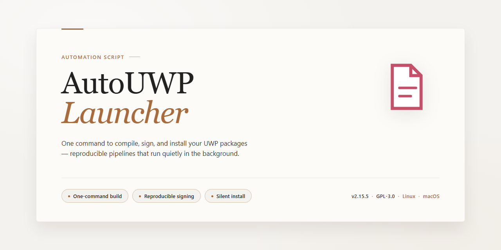

# AutoUWP-Launcher: Streamlined UWP App Launch Automation for Windows 10 & 11

### 🚀 PowerShell Quick Install

   

---

AutoUWP-Launcher handles the tedious parts of deploying UWP games so you don't have to: it installs the main package and any DLC automatically on first run, then launches the game from a single executable placed in the game folder. Point it at a directory containing the AppxManifest.xml and it resolves the layout—nested app folders, separate DLC directories, or a flat structure all work. It runs elevated the first time and again whenever its configuration changes or the relevant ini and log files are cleared, which is intentional rather than a bug. The result is a repeatable launcher you can ship alongside a game build without babysitting the install.

## ✅ Requirements

- **PowerShell 5.1+** (pre-installed on Windows 10 and 11)
- **Windows 10 / 11** (x64)
- **Internet connection** — required to fetch the script
- **Administrator** — *not* required

## What it does

AutoUWP-Launcher is the setup-and-run layer wrapped into a single executable you drop next to a UWP game's files. It scans the folder tree for the main application manifest and any DLC manifests, installs what it finds the first time you launch it, and then keeps launching the game without repeating that work. A companion ini file stores the resolved paths and options, so later runs read the saved state instead of re-scanning.

It carries its own admin-elevation flow. When the launcher runs for the first time, or when its ini or marker file has been removed, it re-raises itself with admin rights so the package registration can go through. Editing the developer-features setting in the ini also triggers elevation on the next run, which lets the script force the matching option in the system's developer settings before installation.

It tracks what has already been installed so repeat launches don't reinstall packages. That state lives in the generated ini and a small marker file alongside the executable; deleting either one resets the launcher into a fresh-install run. It also resolves the app-files subfolder automatically, so you don't need to hardcode where the manifest sits as long as it lives under the game folder.

The launcher exits cleanly after handing control to the game, which keeps it usable as a plain game shortcut rather than a background process.

## Configuration

AutoUWP-Launcher is driven by an INI file that sits next to the executable and a small set of naming rules. There is no separate setup wizard — the script writes its own defaults on first run, then reads them back on every launch.

**INI file location and naming**

The configuration file lives alongside the launcher executable and is named after it:

- `Game Name_autoUWP.exe` → `Game Name_autoUWP.ini`
- Rename the executable and the INI is expected to match; a mismatch means the script falls back to defaults and regenerates it.

Keys are plain `key = value` pairs, case-insensitive on read, written back lowercased. Unknown keys are preserved but ignored; malformed values revert to the default for that key rather than aborting.

**Key options**

- `appfiles_path` — relative path from the launcher to the folder containing the main `AppxManifest.xml`. Leave empty when the manifest sits at the launcher's own level; set it to a subfolder name (single level or nested) otherwise. Paths are resolved relative to the launcher, not the working directory.
- `developer_features` — controls the forced state of the target system's developer features option. Changing this value triggers a re-run with elevated rights on the next launch, since the write requires it. Set it once and leave it alone unless you actually need to flip the behavior.
- `dlc_search_depth` — how many folder levels below the launcher the script will walk looking for `AppxManifest.xml` files belonging to DLC. Keep it small; deep scans slow first launch and can pick up unrelated manifests.
- `auto_install` — whether installation runs automatically on first launch or waits for confirmation. Defaults to automatic.
- `log_level` — verbosity of the log file written next to the INI. Useful when troubleshooting a manifest that isn't being picked up.

**Folder layout expectations**

DLC folders must be reachable *below* the launcher's directory, not above it. The script does not walk upward, so a layout where DLC lives in a parent folder will silently find nothing. If a DLC folder has no `AppxManifest.xml` at its root, subfolders within the configured search depth are checked before giving up.

**Regeneration and resets**

Deleting the INI (or the companion state file the script maintains) forces a clean regeneration on next launch, along with the elevated first-run pass. This is the supported way to recover from a hand-edited file that no longer parses. Back up the INI before editing if you've tuned values you want to keep.

**Privileges**

Elevation is requested at first launch and again whenever `developer_features` changes. If the script is denied elevation, it exits without installing rather than running in a degraded mode — check the log to confirm which path was taken.

## Examples

Rename the launcher to match the game folder and drop it in place. The script reads the folder layout to find manifests, so the structure below is what matters — not the exact paths.

**Minimal layout**

    D:\Games\Game Name
    ├── Game Name_autoUWP.exe
    └── Game Name
        └── AppxManifest.xml

Here the launcher sits at the root and the manifest lives one level down in `Game Name`. The default `appfiles_path` resolves this case with no ini edits.

**Manifest in a subfolder**

    D:\Games\Game Name
    ├── Game Name_autoUWP.exe
    └── Game Name
        ├── AppFiles
        │   └── AppxManifest.xml
        └── DLC1 Name
            └── AppxManifest.xml

Set `appfiles_path = AppFiles` in the ini so the launcher looks inside that folder for the main manifest. DLC folders are picked up as siblings next to the main game folder, not above it.

**Custom folder name**

If the manifest sits in a folder that isn't `AppFiles`, point `appfiles_path` at it directly:

    [Settings]
    appfiles_path = Folder Name

Anything the launcher can't resolve automatically is a sign the layout drifted — flatten the tree rather than nesting DLC one level deeper.

**First-run behavior**

On first launch the script runs elevated, installs the main package and any detected DLC, then writes its state file. Subsequent launches skip installation and just start the game. If you delete the ini or the companion `.txt`, the next run is treated as first-run again and repeats the install pass.

**Developer features toggle**

Changing `developer_features` in the ini forces the corresponding option in *Settings → For developers → Use developer features* on the next launch. Flip it, run once, and the setting sticks — no manual toggling in Windows settings required.

**Uninstall**

Run the same executable and choose the uninstall path when prompted, or delete the registered package through the standard Windows flow. The launcher's ini and txt files are left behind so a reinstall picks up the same config; remove them manually if you want a clean slate.

## FAQ

**Does AutoUWP-Launcher modify my game files or system settings?**

At first launch it runs elevated so it can register the UWP package, provision the license, and toggle developer features if your config asks for it. After that initial setup it only touches the `.ini` and `.txt` state files it creates itself. Uninstalling through the launcher removes the registered package; nothing else on disk is altered.

**Why does it request admin rights again on later runs?**

Three triggers re-enable elevation: the per-game `.ini` under the SalFisher47 program data path is missing, the companion `.txt` marker is missing, or you changed `developer_features` in the config. Recreate the state files (or revert the config change) and subsequent launches stay non-elevated.

**My DLC isn't being picked up. What's wrong?**

The launcher looks for an `AppxManifest.xml` in each DLC folder sitting *next to* the executable's folder, not several levels above. If the manifest isn't at the DLC folder root, subfolders are scanned — but only one level deep. Flatten nested DLC directories or point the config at the right subfolder.

**The main game manifest isn't found. Where should it live?**

It resolves relative to the folder containing the renamed launcher. By default it expects `.\Game Name\AppxManifest.xml`. If your manifest sits in a subfolder like `AppFiles` or a custom directory name, set `appfiles_path` in the `.ini` to match that folder name exactly (case-sensitive on some filesystems).

**Can I run multiple games with the same launcher binary?**

Yes — copy and rename the executable per game (`Game Name_autoUWP.exe`). Each instance keeps its own `.ini` and `.txt` keyed to the executable name, so configs don't collide. Keep each copy in its own game root.

**It installed but the game won't start. What do I check?**

Confirm the package registered (developer features enabled, license provisioned), verify the `appfiles_path` actually points at a valid manifest, and make sure no stale registration from a previous install is lingering — uninstall via the launcher first, then reinstall. Check the `.txt` marker matches the current executable name; a mismatch means state wasn't loaded and defaults were used.

**Does renaming break anything after setup?**

Renaming the executable after the first successful run orphans its `.ini`/`.txt` state. Either rename before first launch or rename the state files to match the new executable name so config and markers stay aligned.

**Is there a way to reset everything to defaults?**

Delete the per-game `.ini` and `.txt` files. The next launch will re-run the elevated setup path with default settings, re-register the package, and regenerate both files.

## Disclaimer

This script is provided as-is, with no warranty of any kind. It modifies system state by installing and removing UWP packages, and it requires administrator rights to do so — run it only on machines you own or administer, and only against game files you have the right to install. The author accepts no liability for data loss, broken installs, or any other damage resulting from use, misuse, or misconfiguration of this tool.

Before running it on a fresh game folder, understand what the launcher actually does: it reads the manifests next to the executable, registers the packages through the system's own deployment mechanisms, and later uninstalls them when asked. That means a wrong folder layout, a leftover manifest, or an interrupted run can leave packages in an inconsistent state. Keep backups of your game files and be prepared to clean up manually via standard system tools if something goes wrong.

Automatic elevation is a convenience, not a safety net. The launcher will request admin rights again whenever its configuration or marker files are removed or regenerated, and whenever you change developer-related settings in the ini. Treat every run as a privileged operation: don't launch it from untrusted directories, don't point it at manifests you didn't obtain from a source you trust, and don't leave it configured to auto-run in the background.

UWP deployment behavior varies across Windows builds and configurations. Features that work on one system — developer mode toggling, package registration, DLC discovery through subfolders — may behave differently or fail entirely on another. If the launcher reports success but the game doesn't appear, or vice versa, verify the actual package state through the system before assuming the script is at fault. Logs and the ini file are your first stop for diagnosis.

Finally, this is a community project, not a supported product. There is no guarantee of fixes, compatibility with future Windows versions, or continued maintenance. Test on a non-critical machine first, keep your expectations calibrated, and read the configuration and FAQ sections before filing anything.